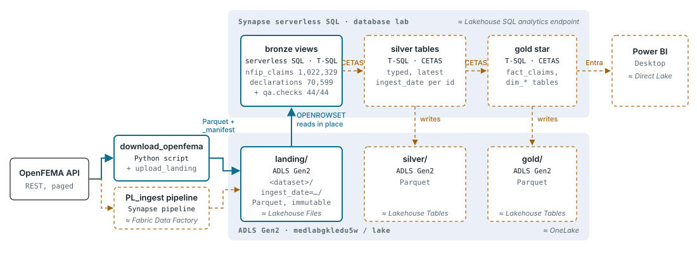
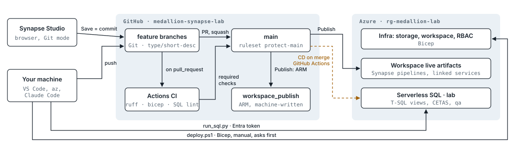

# medallion-synapse-lab

Practice medallion (bronze/silver/gold) on Azure Synapse serverless SQL over ADLS Gen2, using
public FEMA NFIP flood-insurance claims data. Built to practice layering and to map the design
onto Microsoft Fabric (ADLS → OneLake shortcuts, Synapse → Lakehouse/Warehouse, ADF → Fabric Data Factory).

## Architecture

Blue = live data path, solid = built, dashed amber = planned, "≈" = Fabric equivalent.





Captions, the Fabric mapping and build status: [docs/architecture.md](docs/architecture.md).
Full styled page: [docs/architecture/architecture.html](docs/architecture/architecture.html).

## Infrastructure

`infra/main.bicep` (subscription scope) creates:

- Resource group `rg-medallion-lab`
- ADLS Gen2 storage account with containers `lake` (data) and `synapse` (workspace system files)
- Synapse workspace: serverless SQL only, Entra-only auth, firewall open to the deployer's IP
- Storage Blob Data Contributor for the workspace identity and the deployer
- Monthly cost budget (default $10) alerting subscription Owners
- Optional Spark pool (`-DeploySparkPool`): Small, 3 nodes, auto-pause after 5 minutes
- Synapse Git integration with this repo (collaboration branch `main`, root folder `synapse/`)

```powershell
az login
./scripts/deploy.ps1 -WhatIf   # preview, creates nothing
./scripts/deploy.ps1           # deploy
./scripts/teardown.ps1         # delete the resource group when done
```

If your public IP changes, re-run `deploy.ps1` to update the firewall rule.
