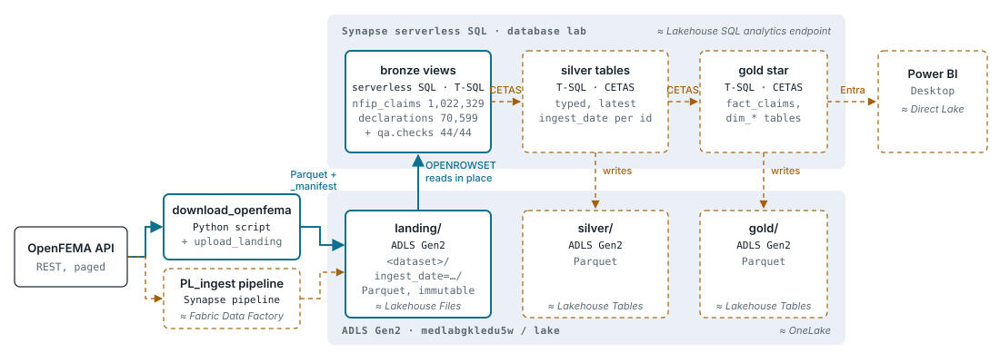
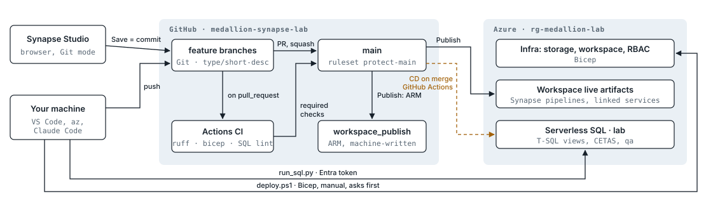

# Architecture

_As of 2026-11-17._ Blue = the live data path, solid = built, dashed amber = planned.
"≈" marks the Microsoft Fabric equivalent. Full styled page:
[architecture/architecture.html](architecture/architecture.html) (open it in a browser). Update the HTML and the SVGs
in [architecture/](architecture/) together when a planned piece is built.

## Data path

Only the blue path exists today. Bronze copies nothing: its views read the landing Parquet where
it lies and take `ingest_date` from the folder name. Silver and gold will be CETAS, which writes
new Parquet to the lake and can't overwrite, so every rebuild deletes the folder first
(`/rebuild`).

## Delivery path

Everything reaches `main` by a PR that passed CI, including Studio work, because Studio commits
as the user (D9). Publish from `main` is the only way pipelines go live (≈ Fabric Git
integration). Infra stays a manual `deploy.ps1`, so no IP, object ID or password is stored in
GitHub (D7). The dashed CD job (plan step 4) will run changed `sql/` files and the checks after a
merge.

## Fabric mapping and status

| Fabric | This lab | Status |
|---|---|---|
| OneLake | ADLS Gen2 `medlabgkledu5w`, container `lake` | live |
| Lakehouse Files | `landing/`, snapshot 2026-11-16 (187 files) | live |
| SQL analytics endpoint | Serverless SQL, database `lab`, bronze views + qa checks | live |
| Lakehouse Tables | Silver and gold CETAS Parquet | silver design §1 |
| Workspace Git integration | Synapse Git to this repo, root `/synapse`; merged (PR #3), Git mode on `main` | live; first Publish pending |
| Deployment pipelines | GitHub Actions CI on PR (step 1); CD on merge (step 4) | CI live |
| Data Factory | Synapse pipelines, metadata-driven ingest (step 3); spike `PL_spike` + linked services on `main` (PR #7) | spike, not run |
| Direct Lake report | Power BI Desktop on the serverless endpoint | planned |
| Notebooks + Delta | Spark pool + Delta (step 5, optional) | deferred (cost) |
| Shortcuts, mirroring, capacity | No equivalent | n/a |

Details: [fabric_parity_plan.md](fabric_parity_plan.md), [decisions.md](decisions.md).
